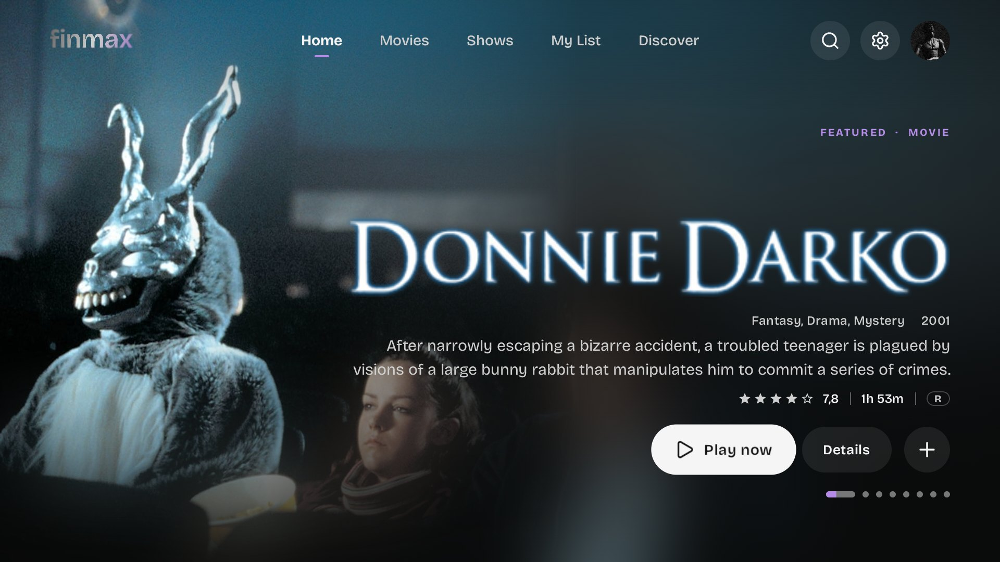
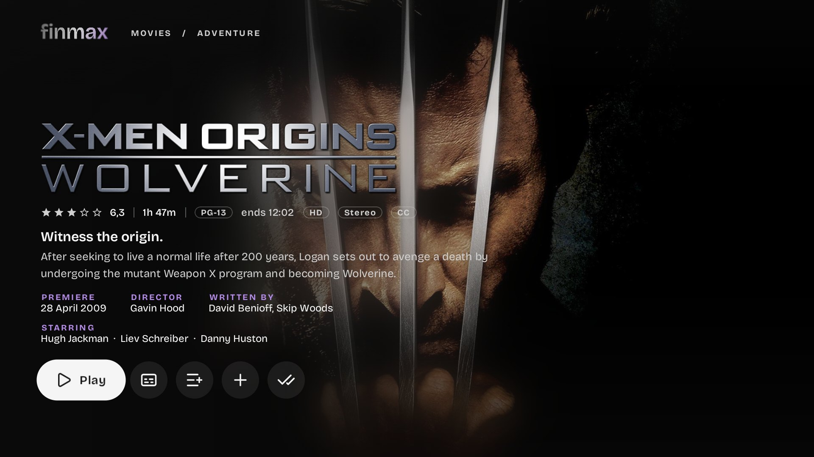
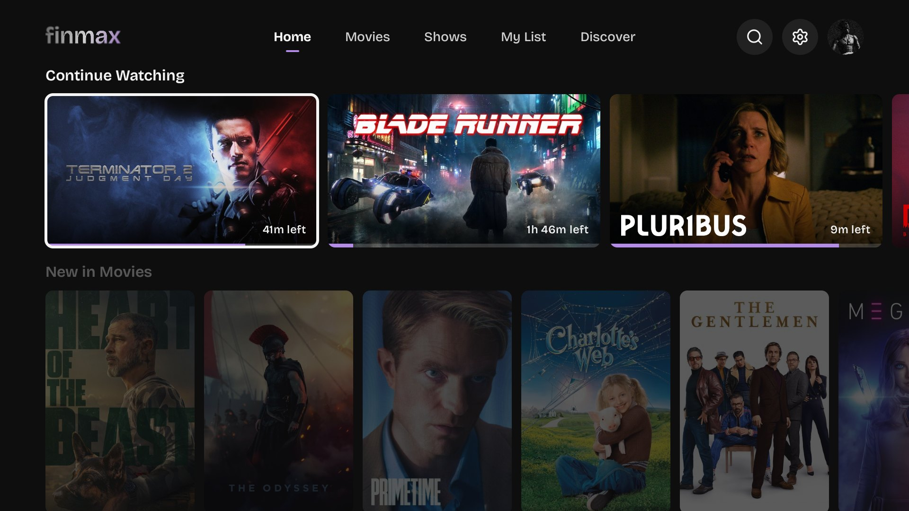
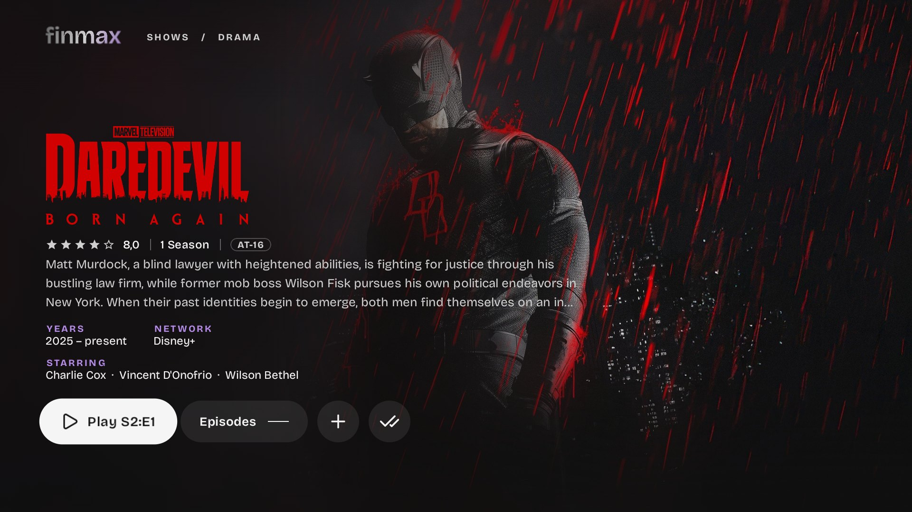
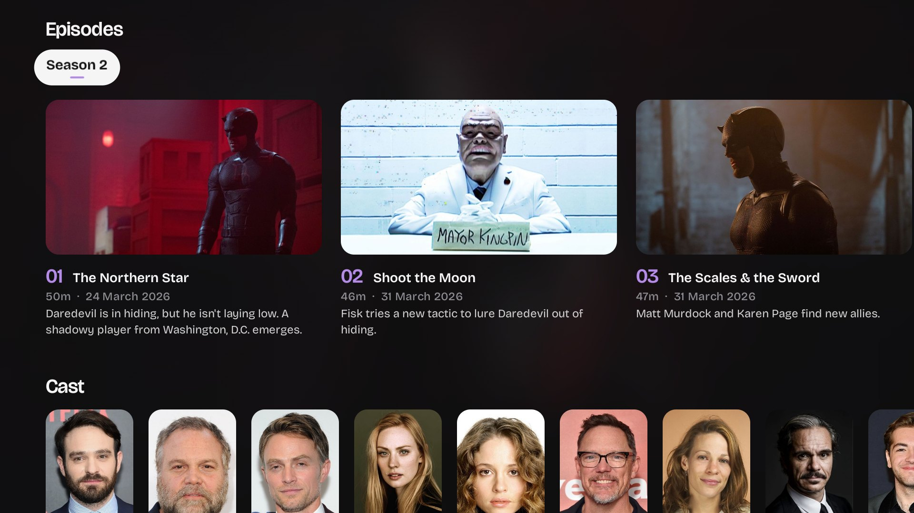
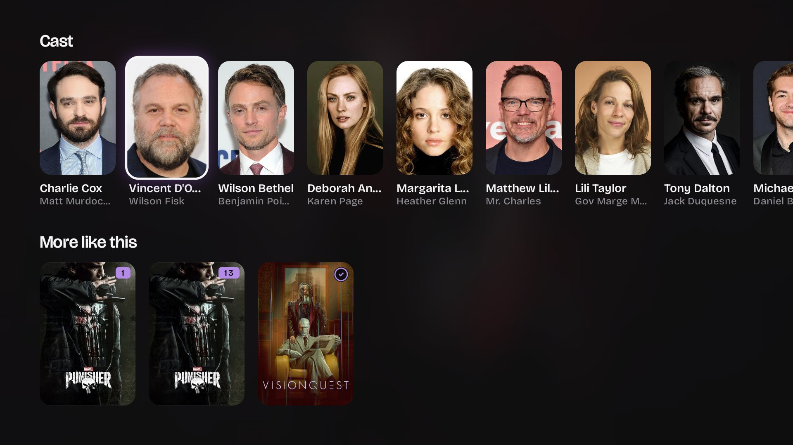
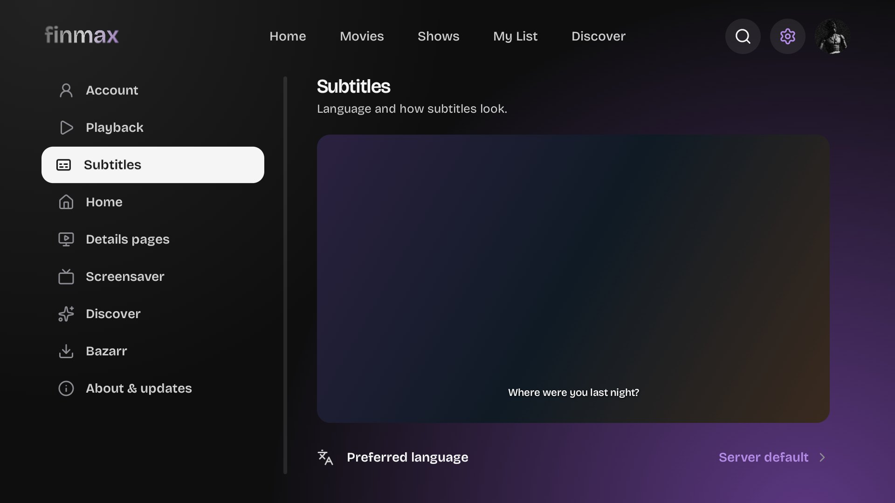

<div align="center">

<picture>
  <source media="(prefers-color-scheme: dark)" srcset="assets/finmax_logo_white.png">
  
</picture>

### A cinematic Jellyfin client for Android TV.

Frosted glass, living backgrounds, and a player that fixes your subtitles.

[](https://github.com/ILostXD/finmax/releases/latest)
[](https://github.com/ILostXD/finmax/releases)
[](LICENSE)


[**Download**](https://github.com/ILostXD/finmax/releases/latest) · [Install](#-install) · [Features](#-features) · [Build](#-build-from-source) · [Architecture](#-architecture)

<br>



</div>

<br>

> [!WARNING]
> finmax is in **alpha**. It's used daily on a Chromecast with Google TV, but expect rough edges, and please [open an issue](https://github.com/ILostXD/finmax/issues) when you find one.

## ✨ Features

<table>
<tr>
<td width="50%" valign="top">

### 🎬 Browsing that feels like a cinema
- **Hero carousel** of unwatched titles, then rows that glide up on Down.
- **Live previews**: a card you rest on plays its own footage and hands it straight to the player, with no restart.
- **Details pages** whose background *is* the film: the clip plays behind frosted glass that blurs the video itself.
- **Cast pages** for every actor, with their whole filmography in your library.
- Continue Watching and Next Up, optionally **merged into one row**.
- **Reorder or hide Home rows**, browse **playlists**, genres and collections.

</td>
<td width="50%" valign="top">

### ▶️ A player that just works
- **Two engines**: ExoPlayer, plus **mpv** for full ASS/SSA styling, picked automatically per file.
- **Direct Play first**; the server only converts what the TV really can't decode.
- **Refresh-rate matching**: 23.976 fps films play at 23.976 Hz.
- **Episode queue**, skip intro/recap/credits, trickplay thumbnails, Up Next.
- Dolby and DTS audio decoded on the device (FFmpeg) when the TV can't.
- **AV1** through software decoding, within what the device can handle.

</td>
</tr>
<tr>
<td valign="top">

### 💬 Subtitles that line up
- **Live delay** in steps, remembered per title and track.
- **Sync assistant** that tells a constant offset from a frame-rate mismatch or a different cut.
- **Sync to a line**: press OK as a line is spoken; two points also fix drift.
- Search and download from Jellyfin's providers or **Bazarr**.
- Netflix-style **drop shadow**, size, background and position.

</td>
<td valign="top">

### 🍿 Everything around it
- **Discover** powered by Seerr/Jellyseerr: trending, genres, search, request status and one-press requests, with season picking for shows.
- **Who's watching** profiles with optional **PIN locks**.
- **Screensaver**, inside the app and as the Android TV screensaver.
- **In-app updates** straight from GitHub releases.
- Quick Connect sign-in, server discovery, Keystore-encrypted tokens.

</td>
</tr>
</table>

## 📸 Screenshots

<div align="center">
<table>
<tr>
<td></td>
<td></td>
</tr>
<tr>
<td align="center"><sub><b>Details</b> · artwork melting into frosted glass</sub></td>
<td align="center"><sub><b>Home rows</b> · the focused card opens into its art</sub></td>
</tr>
<tr>
<td></td>
<td></td>
</tr>
<tr>
<td align="center"><sub><b>Series</b> · pick up the next episode</sub></td>
<td align="center"><sub><b>Episodes</b> · seasons at a glance</sub></td>
</tr>
<tr>
<td></td>
<td></td>
</tr>
<tr>
<td align="center"><sub><b>Cast</b> · every actor has their own page</sub></td>
<td align="center"><sub><b>Settings</b> · a live preview of your subtitle style</sub></td>
</tr>
</table>
<sub>Captured on a Chromecast with Google TV.</sub>
</div>

## 📦 Install

No computer and no developer mode needed.

1. On the TV, install **Downloader** (by AFTVnews) from the Play Store.
2. Allow it to install apps: *Settings → Apps → Security & restrictions → Unknown sources → Downloader*.
3. Open Downloader and enter:
   ```
   https://github.com/ILostXD/finmax/releases/latest/download/finmax.apk
   ```
4. Install, open **finmax**, and sign in to your Jellyfin server.

Updates arrive inside the app: a dot appears on the Settings icon, and one press installs the new version.

<details>
<summary><b>Install with ADB instead</b></summary>

```bash
adb install -r finmax.apk
```

</details>

## 🛠️ Build from source

Needs JDK 17 and the Android SDK (platform 36).

```bash
./gradlew :app:assembleRelease
```

```bash
adb install -r app/build/outputs/apk/release/app-release.apk
```

Always run the **release** build on a TV: debug Compose is about four times slower on low-end hardware.

```bash
./gradlew :app:testDebugUnitTest
```

Add `-Pscreenshots` to render every screen at 1080p into `app/build/screenshots/`, against a fake server, with no TV needed.

## 🧭 Architecture

Kotlin, Jetpack Compose for TV, Media3 (ExoPlayer + an mpv engine), the official Jellyfin Kotlin SDK, Coil 3 and OkHttp. No DI framework and no navigation library: a small app container (`FinmaxApp`) and a back stack (`ui/Navigator.kt`) keep it light.

| Path | What lives there |
|---|---|
| `data/` | Sessions, servers and users, every library call (`MediaRepository`), Seerr and settings, Keystore-encrypted secrets. All SDK calls run off the main thread. |
| `playback/` | Device codec detection and the Jellyfin device profile, `PlayerController` (play decision, tracks, progress, segments, queue), `MpvPlayer`, refresh-rate switching. |
| `subtitles/` | SRT/VTT/ASS parsing, `SyncAnalyzer` (unit tested), the sync assistant, subtitle sources and Bazarr. |
| `update/` | GitHub release checks and installs. |
| `ui/` | Every screen, plus shared components and the theme. |

<details>
<summary><b>How the subtitle sync assistant works</b></summary>

finmax downloads every text subtitle as SRT and renders it itself, so timing changes live without restarting playback. The correction is linear: `shown = t × scale + offset`.

1. Reads the file name, frame rate, runtime and selected subtitle.
2. Compares dialogue timing against a reference track. Embedded tracks are trusted; another external file only counts as a labelled guide.
3. Classifies the problem:
   - **constant offset**: a delay fixes it;
   - **frame-rate mismatch**: needs a speed change, e.g. 23.976 ↔ 25 fps;
   - **different cut**: offsets jump between sections, and it says so;
   - **unknown**.
4. Ranks alternatives: other tracks, server providers (hash matches count strongly) and Bazarr, by release name, edition and measured alignment.
5. Nothing changes until you Preview and Apply. Downloads happen only on Apply.

</details>

## 🗺️ Roadmap

- [x] Playlists, Home row editor, profile PINs
- [x] mpv engine, refresh-rate matching, AV1
- [x] Screensaver and in-app updates
- [ ] Discover polish
- [ ] Theme music
- [ ] Music, Live TV and photo libraries (hidden for now, not faked)

## 🙏 Acknowledgements

- [Jellyfin](https://jellyfin.org), for the server and the Kotlin SDK.
- [Wholphin](https://github.com/damontecres/Wholphin), the functional reference.
- [libmpv-android](https://github.com/jarnedemeulemeester/libmpv-android) via Findroid, [Media3](https://developer.android.com/media/media3), [Lucide](https://lucide.dev) icons and [Bricolage Grotesque](https://github.com/ateliertriay/bricolage).

finmax isn't affiliated with Jellyfin, Netflix or Seerr.

## 📄 License

[GPL-3.0](LICENSE)
